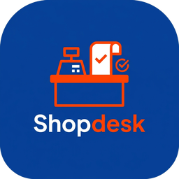
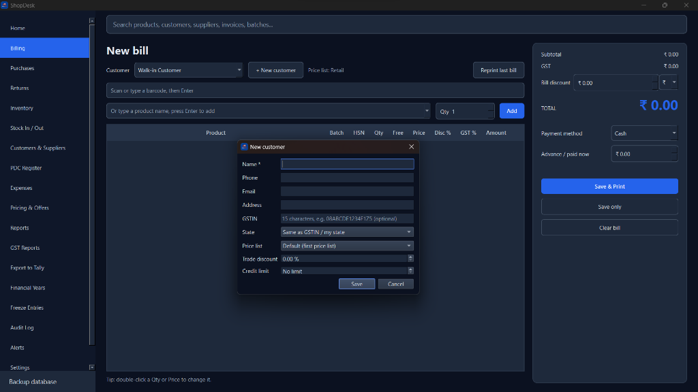
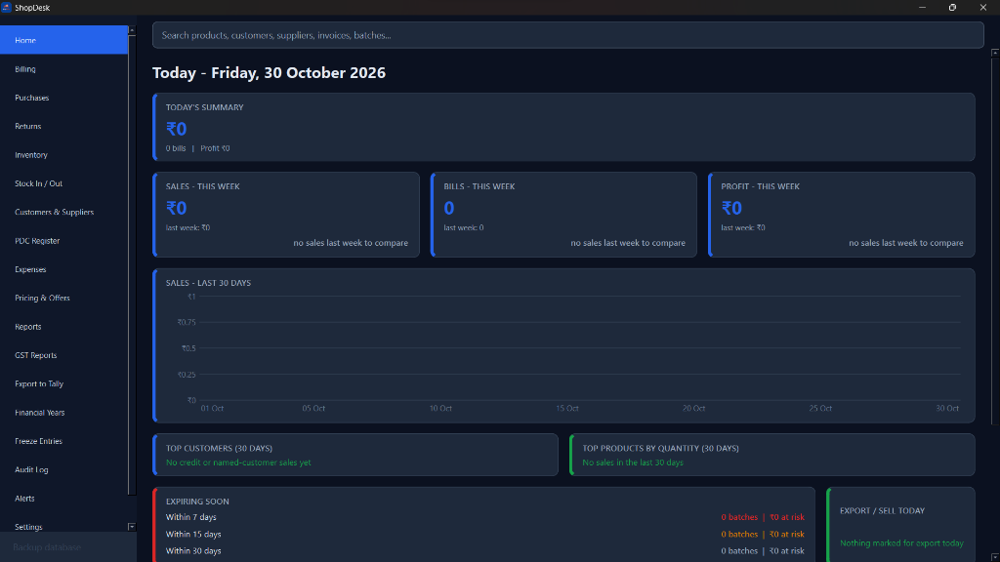
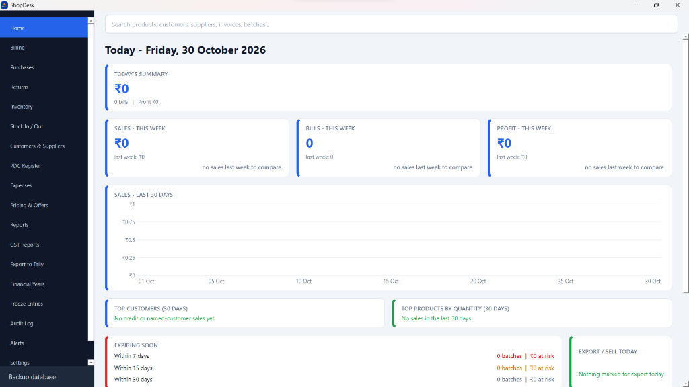

> **Notice:** This repository is source-available for demonstration and architectural inspection only. Copying the design, audio sprite mechanics, or deploying clones is strictly prohibited.

<div align="center">



# ShopDesk

**Complete Offline Billing, POS, Inventory, GST Invoicing & Accounting Desktop Suite**

*Engineered for retail counters, wholesale distributors, and multi-location warehouses.*

[](releases/ShopDesk-Setup-0.0.4.exe)
[](releases/ShopDesk-Setup-0.0.4.exe)
[](#where-the-data-lives)
[](#gst-compliance-and-reporting)
[](#tally-integration)
[](#where-the-data-lives)

<br />

<p align="center">
  <a href="releases/ShopDesk-Setup-0.0.4.exe">
    
  </a>
</p>

<p align="center">
  <b>Standalone Windows Installer (.exe)</b> · Zero Python runtime needed · Installs in seconds
</p>

</div>

---

## 📸 Interface Tour

### High-Speed POS & Billing Terminal
> Rapid barcode scanning, product autocomplete, customer credit limits, instant batch selection, dynamic discounts, and one-key thermal/A4 receipt dispatch.

<p align="center">
  
</p>

---

### Real-Time Analytics & Operations Dashboard
> Track today's summary, weekly turnover, net profit, 30-day sales trends, top customers, and automated batch expiry alerts.

| 🌙 Dark Mode Dashboard | ☀️ Light Mode Dashboard |
| :---: | :---: |
|  |  |
| *High-contrast dark theme for long shifts & modern screens* | *Clean daylight theme optimized for high-glare store counters* |

---

## ⚡ Highlights at a Glance

| Category | Capabilities |
| :--- | :--- |
| **Point of Sale (POS)** | Barcode scanner support (Code 128), keyboard-first data entry, price lists (Retail / Wholesale / MRP), customer credit limits, 30-second draft auto-recovery. |
| **Inventory & Batches** | Batch-wise stock tracking, manufacturing & expiry monitoring, godown reorder levels, 30-day predictive purchase suggestions, auto barcode label generator (`SD000012`). |
| **GST & Invoicing** | Auto CGST/SGST vs IGST calculation, HSN code verification (4/6/8 digits), GSTR-1 & GSTR-3B monthly report summaries (Excel/CSV/PDF), customizable prefix series (`RET-`, `WHO-`). |
| **Accounting Tools** | Post-Dated Cheque (PDC) register with maturity reminders, multi-bank cheque printing (HDFC, SBI, ICICI), Cash Book vs Bank Book, P&L, Balance Sheet, Ledger statements. |
| **Audit & Security** | Immutable Audit Log tracking every creation, price edit, stock write-off, and invoice void. Permanent entry freezing with tamper prevention. |
| **Printing Hardware** | Thermal receipt printers (80 mm & 58 mm auto-cut), standard A4 Tax Invoices, direct Windows print spooler integration, instant WhatsApp PDF export. |
| **Data Sovereignty** | 100% offline local SQLite database. Zero cloud dependencies, zero latency, one-click backup to USB flash drive or local cloud folders. |

---

## 📥 Download & Installation (Windows)

1. **Download the installer:**
   * **[Download ShopDesk Setup v0.0.4 (`ShopDesk-Setup-0.0.4.exe`)](releases/ShopDesk-Setup-0.0.4.exe)**
2. Double-click `ShopDesk-Setup-0.0.4.exe` to run the setup wizard.
3. Launch ShopDesk from your desktop shortcut or Start Menu.
4. *No Python, terminal, or database configuration required!*

---

## 🚀 Quick Start Guide

### 1. First-Time Setup
* Navigate to **Settings** from the sidebar.
* Enter your **Shop Name**, **Address**, **Phone**, and **GSTIN**.
* Configure your primary **Bill Paper Format**:
  * **A4 Full Page** (Standard Laser/Inkjet Tax Invoice)
  * **Thermal 80 mm** (Standard POS Roll)
  * **Thermal 58 mm** (Compact POS Roll)
* Choose whether **"Prices include GST"** matches your retail pricing model.
* Click **"Preview a sample bill"** to test and verify printer margins.

### 2. Daily Counter Workflow
* **Billing:** Scan a barcode or type a product name, adjust quantity, and press **Enter** to add. Click **Save & Print** (`Enter`) to dispatch.
* **Stock In / Out:**
  * Use **Receive Stock** when shipments arrive from suppliers (records batch, expiry date, purchase price, and landing cost).
  * Use **Adjust / Write Off** to record damaged, expired, or sample inventory.
* **Customers & Suppliers:** Manage account balances, credit limits, trade discounts, GSTINs, and record incoming/outgoing payments.
* **GSTIN Automation:** Your shop GSTIN prints on every tax invoice. When a customer profile has a registered GSTIN, B2B tax invoice fields automatically populate.

---

## 📦 In-Depth Feature Breakdown

### 🛒 Point of Sale & Invoicing
* **Dynamic Search:** Global top bar instantly searches products, customers, suppliers, invoices, and batch numbers.
* **Draft Auto-Recovery:** In-progress bills and purchases automatically auto-save every 30 seconds. If power cuts or unexpected shutdowns occur, ShopDesk prompts you to restore your exact session state upon relaunch.
* **Invoice Series:** Maintain separate series for retail and wholesale transactions (e.g., `RET-0001`, `WHO-0001`). GSTR-1 reporting lists each series separately.
* **Price Schemes & Offers:** Support for fixed product pricing, customer-specific trade discounts, and promotional Buy-X-Get-Y-Free schemes.
* **Bill Cancellation:** Safely cancel an invoice with mandatory audit justification. Stock automatically returns to inventory, customer balances roll back, and cancellation reasons are preserved permanently in the Audit Log.
* **One-Click Reprint:** Instantly reprint the last issued bill straight from the billing terminal.

### 📊 GST Compliance and Reporting
* **GSTR-1 & GSTR-3B Generation:** Select any month and financial year to compile GSTR-1 and GSTR-3B tables with one click.
* **Multi-Format Export:** Export GST filings directly to Excel, portal-formatted CSVs (individual files per table), or printable PDF summaries for your Chartered Accountant.
* **Intra-state vs Inter-state:** Customer and supplier state codes automatically steer taxes between Intra-state (CGST + SGST) and Inter-state (IGST).
* **Controlled Tax Slabs:** Define and manage allowed GST tax rates in Settings. Bulk migration tools allow moving products across slabs while preserving legacy invoices.
* **HSN Validation:** Enforces standard 4, 6, or 8-digit HSN codes across all inventory items.

### 💼 Marg-Style Accounting & Enterprise Controls
* **PDC Register (Post-Dated Cheques):** Full lifecycle management for incoming and outgoing cheques (Pending, Deposited, Cleared, Bounced). Automated daily alerts highlight cheques maturing this week.
* **Cheque Printing:** Direct cheque printing for supplier settlements and PDC payments. Includes precision layouts for **HDFC**, **SBI**, and **ICICI**, with numeric-to-words currency translation and visual calibration tools.
* **Financial Year Operations:** Transactions are tagged by financial year. Closing a financial year seals records to read-only status and carries opening balances forward.
* **Tamper-Proof Entry Freezing:** Freeze finalized bills, purchases, vouchers, and expenses with a cryptographic lock icon. Frozen records cannot be modified or deleted, satisfying regulatory audit requirements.
* **Comprehensive Financial Statements:**
  * Day Book, Cash Book, and Bank Book (UPI, Cards, Cheques, NEFT/RTGS)
  * Customer & Supplier Ledger statements with ageing breakdown
  * Stock valuation report (FIFO & batch-wise)
  * Profit & Loss Statement and Balance Sheet

### 🔗 Tally Integration
Export sales and purchase ledgers seamlessly into Tally ERP 9 / TallyPrime:
1. Open **Export to Tally** from the sidebar.
2. Select target date ranges and ledger accounts.
3. Generate the standard XML export files (**Ledgers.xml** and **Vouchers.xml**).
4. Import into Tally via *Import Data > Masters*, followed by *Import Data > Vouchers*.

### 🏷️ Barcodes, Labels & Multi-Currency
* **Barcode Generation:** Automatically generates unique Code 128 barcodes (`SD000012`) for unbarcoded items.
* **Label Sheet Printing:** Print barcode labels directly onto standard A4 sticker sheets or continuous thermal label rolls.
* **Multi-Currency Transactions:** Store transactions with daily exchange rates while maintaining the base currency in INR. Invoices display both foreign currency and domestic equivalents.

---

## ⌨️ High-Speed Keyboard Navigation

ShopDesk is engineered for 100% mouse-free counter operation:

| Key Binding | Function |
| :--- | :--- |
| **`Enter`** | Move to next input field; confirm and save on dialog completion |
| **`Up` / `Down`** | Move between vertical text fields; change values in dropdowns and date pickers |
| **`Left` / `Right`** | Navigate caret inside text; jumps inputs when cursor reaches the boundary |
| **`F-Keys / Shortcuts`** | Customizable in **Settings > Keyboard Shortcuts** |
| **Search / Scan** | Barcode and search fields prioritize scan input without accidental form submission |

---

## 🖨️ Printing & Hardware Compatibility

* **Thermal Receipt Printers:** Compatible with ESC/POS standard 80 mm and 58 mm printers (TVS, Epson, Citizen, Posiflex, NGX). Dynamic document length eliminates blank paper waste.
* **Standard Printers:** High-speed vector rendering for A4 / Letter Laser and Inkjet printers.
* **Digital Invoices:** Instant **Save PDF** enables direct invoice dispatch via WhatsApp or email.

---

## 📁 Where the Data Lives

ShopDesk operates on an air-gapped, zero-cloud architecture. Your business data is stored exclusively on your local machine:

```
%LOCALAPPDATA%\ShopDesk\data\shop.db
(e.g., C:\Users\<Username>\AppData\Local\ShopDesk\data\shop.db)
```

* **Data Preservation:** Uninstalling or updating ShopDesk never deletes your database.
* **One-Click Backup:** Use the **Backup Database** utility in the sidebar to create timestamped archives onto USB flash drives or synchronized folders (Google Drive, OneDrive, Dropbox).

---

## 🛠️ Building the Installer from Source

To compile the standalone Windows installer from source:

### Prerequisites
1. **Windows 10 or 11 (64-bit)**
2. **Python 3.12+** (ensure `python.exe` is added to your system `PATH`)
3. **Inno Setup 6** (from [jrsoftware.org](https://jrsoftware.org/isdl.php) or via `winget install JRSoftware.InnoSetup`)

### Compilation Steps
```cmd
:: 1. Navigate to the project root
cd shopdesk

:: 2. Execute the automated installer builder
BUILD_INSTALLER.bat
```

The script compiles the Python binaries via PyInstaller, bundles UI resources, configures Inno Setup, and outputs:
```
installer_output\ShopDesk-Setup-1.0.0.exe
```

---

<div align="center">

**Built with precision by [NeoShaurya](https://neoshaurya.com)**  
*For questions, architectural discussion, or support, visit [neoshaurya.com/contact](https://neoshaurya.com/contact)*

</div>
